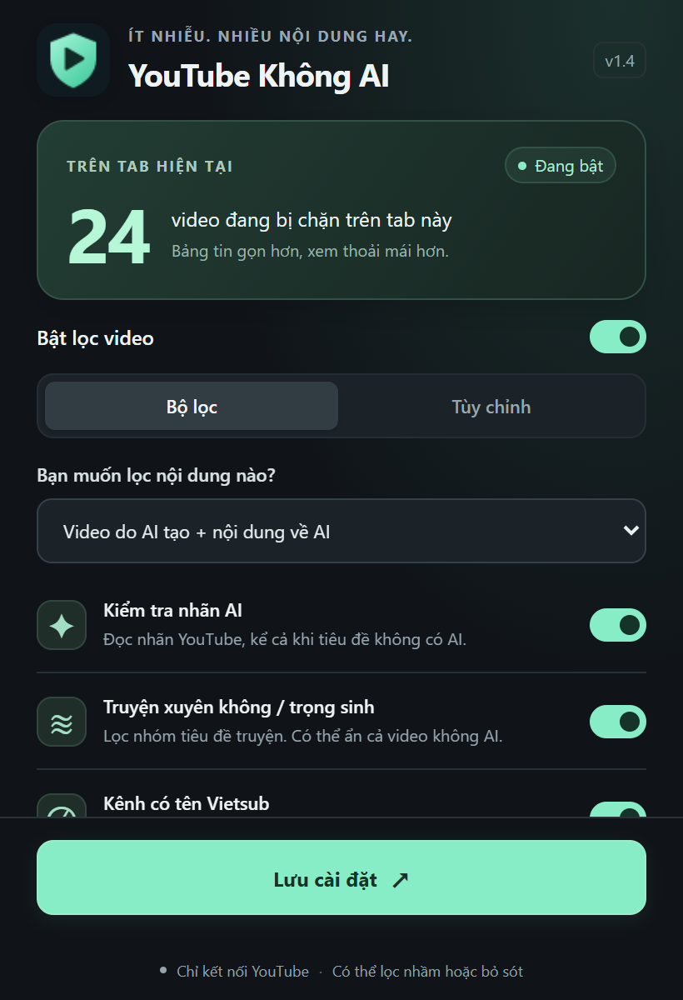
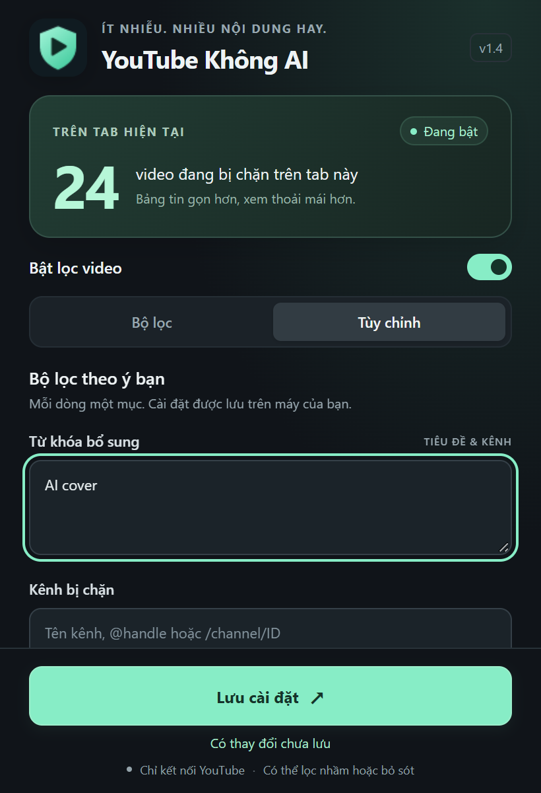

# YouTube No AI — YouTube Không AI


**Ít nhiễu. Nhiều nội dung hay.**

A Chrome / Edge extension for a cleaner YouTube feed. Filter AI-labeled videos, AI topics, unwanted story titles, and channels — with local settings and no developer backend.

Extension Chrome/Edge giúp bạn tùy chỉnh bảng tin YouTube: lọc video có nhãn AI, nội dung nói về AI và những nhóm video/kênh bạn không muốn xem. Chạy trực tiếp, không cần API key, máy chủ hay bước build.

## Tính năng

- **Nhãn AI:** kiểm tra nhãn YouTube dù tiêu đề không chứa từ “AI”.
- **Từ khóa:** lọc nội dung về AI, thêm từ khóa riêng.
- **Lọc thể loại:** tùy chọn ẩn truyện xuyên không / trọng sinh.
- **Lọc kênh:** chặn kênh Vietsub, thêm danh sách chặn hoặc cho phép.
- **Bạn kiểm soát:** hiện lại video, xem lý do lọc hoặc ẩn hoàn toàn.
- **Bộ đếm:** số thẻ video đang bị chặn trên tab hiện tại.
- **Giao diện tiếng Việt:** tông tối, công tắc nhanh, hai tab cài đặt.

> Lọc bằng nhãn và từ khóa, không phân tích hình ảnh/âm thanh. Có thể lọc nhầm hoặc bỏ sót; không cam kết nhận diện mọi video AI. Lọc thể loại và Vietsub là lựa chọn theo sở thích, không phải xác nhận video dùng AI.

## Xem trước

 

Ảnh minh họa giao diện; số đếm 24 là dữ liệu giả lập.

Popup có giao diện tối với điểm nhấn xanh mint, bộ đếm trên tab hiện tại, công tắc bật/tắt và hai tab **Bộ lọc** / **Tùy chỉnh**. Các tùy chọn dài có vùng cuộn; nút lưu luôn nằm dưới cùng. Có thể đổi tab bằng phím mũi tên. Icon khiên kết hợp nút Play có bản SVG gốc trong `icons/icon.svg` và PNG 16/32/48/128 px cho trình duyệt. Ảnh xem trước giao diện tại `output/popup-filters.png` và `output/popup-custom.png` dùng số đếm giả lập để minh họa.

## Cài đặt

1. Mở `chrome://extensions` (Chrome) hoặc `edge://extensions` (Edge).
2. Bật **Developer mode / Chế độ dành cho nhà phát triển**.
3. Chọn **Load unpacked / Tải tiện ích đã giải nén**.
4. Chọn thư mục dự án chứa `manifest.json`. Nếu tải từ GitHub: chọn **Code → Download ZIP**, giải nén trước rồi chọn thư mục đã giải nén.
5. Tải lại các tab YouTube đang mở. Ghim tiện ích để mở bảng cài đặt.

Không cần `npm install` để cài hoặc sử dụng extension. Hiện tại cài bằng Load unpacked; chưa có bản phát hành trên Chrome Web Store.

## Quick start (English)

Download this repository via **Code → Download ZIP** and extract it. Open `chrome://extensions` or `edge://extensions`, enable **Developer mode**, click **Load unpacked**, and select the folder containing `manifest.json`. Reload YouTube and open the extension popup. No build or API key is needed.

Filters use visible text and YouTube AI disclosures, not audio/image analysis. Story and Vietsub channel filters are preference filters. False positives and missed videos are possible. Desktop `www.youtube.com` only; videos already playing are not stopped.

## Sử dụng

- Tự động lọc các thẻ video ở trang chủ, tìm kiếm, danh sách kênh, video đề xuất và thẻ Shorts khi YouTube dùng các cấu trúc DOM được hỗ trợ.
- Ô thay thế cho biết từ khóa gây lọc. **Hiện video** cho phép xem lại video đó trong trang hiện tại; điều hướng sang trang khác sẽ xóa ngoại lệ này.
- **Cho phép kênh** lưu ngoại lệ lâu dài. Danh sách cho phép được ưu tiên hơn danh sách chặn và từ khóa. Video có nhãn AI của YouTube vẫn bị lọc.
- Nhãn **AI / Tạo bằng AI / Made with AI** và nhãn cũ **Altered or synthetic content** được lọc dù tiêu đề không có từ AI. Tiện ích đọc badge trên thẻ và mặc định kiểm tra thêm dữ liệu mô tả từ trang video khi thẻ gần vùng nhìn thấy. Tối đa 2 yêu cầu đồng thời, cách nhau ít nhất 700 ms, không tải/phát video. Có thể tắt kiểm tra thêm trong popup.
- Trong popup: bật/tắt, đổi phạm vi, ẩn hoàn toàn, thêm từ khóa và quản lý danh sách kênh. Bấm **Lưu cài đặt** để áp dụng vào các tab đang mở.
- Popup hiển thị số thẻ video **đang bị chặn trên tab YouTube hiện tại**, cập nhật mỗi giây khi popup mở. Không cộng dồn lịch sử hoặc cộng các tab khác; hiện lại video hoặc tắt lọc sẽ giảm số đếm. Các thẻ cùng video xuất hiện nhiều vị trí được đếm riêng.
- Mặc định bật **Lọc truyện xuyên không / trọng sinh** theo tiêu đề: “xuyên về”, “xuyên không”, “xuyên đến”, “trọng sinh”, “tái sinh”, “chuyển sinh”. Nhóm này lọc ngay cả khi không tìm thấy nhãn AI. Đây là lựa chọn lọc thể loại theo yêu cầu, không phải khẳng định video đó dùng AI. Có thể tắt hoặc cho phép kênh để giữ video thuộc nhóm này.
- Mặc định bật **Chặn kênh có tên Vietsub**: ẩn video khi tên kênh hoặc @handle chứa `Vietsub`, kể cả `Viet Sub`, `Viet-sub`, `Viet_sub`, `Viet.sub`, không phân biệt hoa/thường. Quy tắc chỉ xét kênh, không xét chữ Vietsub trong tiêu đề video hoặc ID kênh. Có thể tắt trong popup hoặc thêm kênh vào danh sách cho phép.
- Mỗi dòng một từ khóa hoặc kênh. Kênh nhận tên chính xác, `@handle`, `/@handle`, hoặc `/channel/ID`. Tên hiển thị có thể trùng; ưu tiên handle hoặc đường dẫn kênh.
- Tắt lọc sẽ khôi phục các thẻ video đã ẩn. Tiện ích không dừng video đang phát hoặc tự bỏ qua Shorts trong trình phát.

## Giới hạn

Đây là bộ lọc từ khóa và nhãn YouTube, không phải bộ phát hiện AI bằng phân tích âm thanh/hình ảnh. Kiểm tra nhãn tải HTML trang xem video từ YouTube, đọc JSON `ytInitialData` trong các phần nhãn của video hiện tại, không chạy script tải về. Chỉ hỗ trợ nhãn tiếng Việt/Anh và các cấu trúc dữ liệu đã nhận diện. Video có thể vẫn hiện trong vài giây trước khi kiểm tra hoàn tất. Nếu YouTube chặn yêu cầu, yêu cầu đăng nhập/đồng ý cookie, trả thiếu dữ liệu hoặc đổi cấu trúc, nhãn có thể bị bỏ sót. Không cam kết phát hiện 100% nhãn.

Nội dung AI không có nhãn hoặc dấu hiệu bằng chữ có thể bị bỏ sót. Video có các từ khóa như AI, Gemini, Claude hoặc Sora có thể bị lọc nhầm. Chế độ chỉ nội dung do AI tạo cũng dựa trên cụm từ và nhãn, không xác minh nguồn gốc video. [YouTube giải thích nhãn Tạo bằng AI](https://support.google.com/youtube/answer/15447836?hl=vi).

So khớp không phân biệt hoa/thường hoặc dấu tiếng Việt, có ranh giới từ để `AI` không khớp với `Thailand` hay `Minecraft`. YouTube thay đổi giao diện thường xuyên; có thể cần cập nhật selector trong `content.js`. Bản này dành cho `www.youtube.com` trên máy tính, không hỗ trợ ứng dụng điện thoại hay `m.youtube.com`.

Chỉ dùng quyền `storage`, lưu cài đặt cục bộ. Kiểm tra nhãn chỉ gửi yêu cầu tới chính YouTube, không gửi cookie đăng nhập. Kết quả lưu tạm trong tab tối đa 500 video, hết hạn sau 1 giờ (lỗi: 10 phút), mất khi tải lại trang. Không có máy chủ bên thứ ba. Manifest V3 và content scripts theo [tài liệu Chrome](https://developer.chrome.com/docs/extensions/develop/concepts/content-scripts).

## Kiểm tra khi phát triển

```powershell
npm install
npm test
npm run check
```

Sau khi sửa code, bấm Reload tại trang quản lý extension và tải lại YouTube. Kiểm tra trang chủ, tìm kiếm, đề xuất và Shorts; thử bật/tắt, hiện lại video, cho phép kênh và chế độ ẩn hoàn toàn.

## Phát hành lên Store

Xem [hướng dẫn và nội dung hồ sơ](store/PUBLISHING.md). [Chính sách quyền riêng tư](store/PRIVACY_POLICY.md) hiện là bản dự thảo; cần bổ sung thông tin nhà phát triển trước khi dùng để đăng Store.

## Báo lỗi

Tạo GitHub Issue kèm link video, vị trí thẻ (trang chủ / tìm kiếm / đề xuất), phiên bản trình duyệt và bộ lọc đang bật. Nếu có thể, gửi ảnh nhãn AI để đối chiếu. YouTube thường thay đổi giao diện nên selector có thể cần cập nhật.

Tiện ích độc lập, không liên kết hoặc được YouTube/Google bảo trợ.
